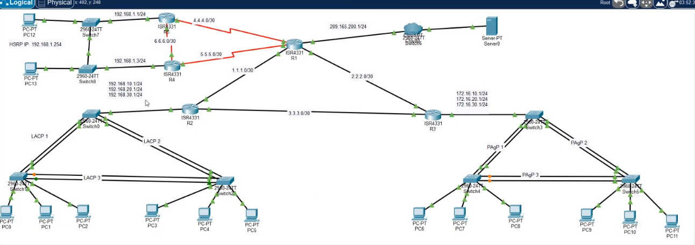

  <h1>Cisco Enterprise Network Infrastructure Lab</h1>
  
<strong>Multi-site enterprise network simulation in Cisco Packet Tracer</strong>

  

    
    
    
    
  

  

    <a href="#network-topology">Topology</a> ·
    <a href="#architecture">Architecture</a> ·
    <a href="#implementation">Implementation</a> ·
    <a href="#testing-and-troubleshooting">Testing &amp; troubleshooting</a> ·
    <a href="#run-the-lab">Run the lab</a>
  

This CCNA lab connects two departmental LANs and a redundant-gateway LAN to a simulated external server segment. It models how VLAN segmentation, resilient switching, dynamic routing, and edge policy interact along an end-to-end packet path.

## Network topology

  
  
<em>Original Packet Tracer logical topology. Select the image to see the full-size diagram.</em>

## Architecture

| Segment | Devices | Design |
| --- | --- | --- |
| R2 departmental LAN | R2, Switch0–2, PC0–5 | Three VLANs with local DHCP, 802.1Q routing on R2, and LACP EtherChannels |
| R3 departmental LAN | R3, Switch3–5, PC6–11 | Three VLANs with local DHCP, 802.1Q routing on R3, and PAgP EtherChannels |
| Redundant-gateway LAN | R4, R5, Switch7–8, PC12–13 | `192.168.1.0/24` with HSRPv2 virtual gateway `192.168.1.254` |
| Routed backbone | R1–R5 | Two OSPF Area 0 triangles linked through R1, using six point-to-point `/30` subnets |
| External server segment | R1, Switch6, Server0 | `209.165.200.0/24`, with R1 at `209.165.200.1` and `209.165.200.100` as the documented ACL destination |

### VLAN and gateway plan

| VLAN | Department | R2 subnet / gateway | R3 subnet / gateway |
| --- | --- | --- | --- |
| 10 | IT | `192.168.10.0/24` / `192.168.10.1` | `172.16.10.0/24` / `172.16.10.1` |
| 20 | HR | `192.168.20.0/24` / `192.168.20.1` | `172.16.20.0/24` / `172.16.20.1` |
| 30 | Sales | `192.168.30.0/24` / `192.168.30.1` | `172.16.30.0/24` / `172.16.30.1` |

When a client sends traffic outside its subnet, the access switching fabric carries its frames to the local gateway over an 802.1Q trunk. For traffic to the other LAN, the router uses its OSPF routing table to select the path. For permitted traffic to the external server, the design places filtering on the R2 ingress subinterfaces and source translation at the R1 edge.

## Implementation

| Technology | Documented design |
| --- | --- |
| VLANs and 802.1Q | VLANs 10, 20, and 30 extend across trunk links. R2 uses `Gi0/0/1.10`, `.20`, and `.30` and R3 uses the corresponding `Gi0/0/0` subinterfaces for router-on-a-stick. |
| EtherChannel and STP | LACP bundles the R2-side switch links and PAgP bundles the R3-side switch links. Rapid PVST+ provides loop prevention per VLAN. PortFast, BPDU Guard, and sticky MAC port security are documented for endpoint-facing ports. |
| OSPFv2 | Process 1 uses Area 0 across R1–R5. R2 and R3 advertise their departmental subnets, R4 and R5 advertise the shared LAN, and R1 is designed to originate a default route when one is installed. |
| DHCP | R2 and R3 host one pool per local VLAN, using the matching gateway and reserving addresses `.1` through `.5` in each subnet. |
| NAT/PAT | R1 uses ACL 1 to select sources in `192.168.0.0/16` and `172.16.0.0/16` for translation toward `Gi0/0/2`. The notes describe PAT as the design goal. Their NAT statement omits the `overload` keyword, so the saved running configuration needs inspection before asserting that PAT is enabled. |
| HSRPv2 | R4 and R5 share group 1 and virtual gateway `192.168.1.254`. The notes give R4 priority 255 and preemption, making it the preferred active router. |
| Extended ACL | R2 applies ACL 100 inbound on the three VLAN subinterfaces. It denies IT HTTP/HTTPS, HR FTP control, and Sales ICMP to `209.165.200.100`, then permits remaining IP traffic. |
| SSHv2 | The router notes specify RSA keys, SSH version 2, and local VTY authentication with SSH-only transport. |

The [validation guide](docs/validation-and-troubleshooting.md) includes the transit addressing plan and commands for checking each feature.

## Testing and troubleshooting

The topology and configuration notes document the design. The [validation guide](docs/validation-and-troubleshooting.md) provides expected outcomes and a procedure for collecting command output. The saved Packet Tracer runtime and pass/fail outcomes were unverified at publication.

| Verify | Start with |
| --- | --- |
| VLAN membership, trunks, and redundant switch paths | `show vlan brief`, `show interfaces trunk`, `show etherchannel summary`, `show spanning-tree vlan 10` |
| Local addressing and inter-site routing | `show ip dhcp binding`, `show ip ospf neighbor`, `show ip route ospf` |
| Intended filtering and edge translation | `show access-lists 100` on R2, `show ip nat translations` on R1, and matching client application tests |
| Gateway failover and secure management | `show standby brief`, a failover exercise in a copy, and `show ip ssh` |

For a failed flow, check link state and VLAN membership first, then verify the source gateway, destination route and return path, and finally ACL counters, NAT entries, and server service state.

## Run the lab

1. Download the repository or clone it with Git.
2. Open [Final Project.pkt](packet-tracer/Final%20Project.pkt) in Cisco Packet Tracer. The separately supplied [Big Lab.pkt](packet-tracer/Big%20Lab.pkt) is also included.
3. Use the [validation guide](docs/validation-and-troubleshooting.md) to inspect the saved state. Create a working copy before attempting any failover exercise or configuration change.

## Repository contents

| Path | Contents |
| --- | --- |
| [`packet-tracer/`](packet-tracer/) | Both original Cisco Packet Tracer projects |
| [`assets/network-topology.png`](assets/network-topology.png) | Original logical topology image |
| [`docs/validation-and-troubleshooting.md`](docs/validation-and-troubleshooting.md) | Transit addressing, test procedure, and diagnostic workflow |
| [`docs/reference/`](docs/reference/) | Original Cisco IOS notes and bilingual study notebook |

**Author** [Ahmed Almassi](https://github.com/amassrywork-collab)

**License** [MIT](LICENSE)
